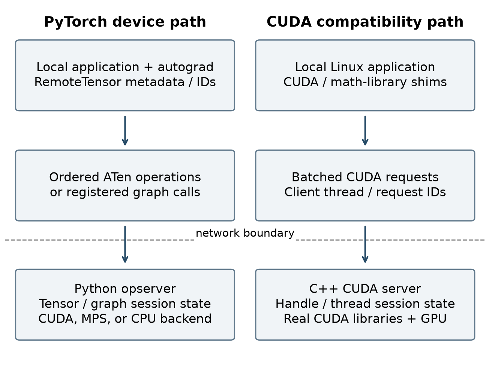
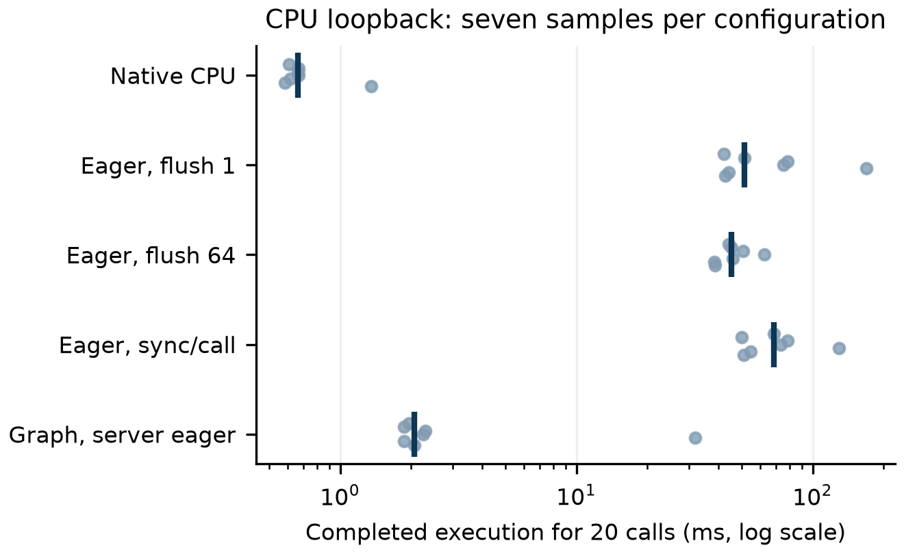
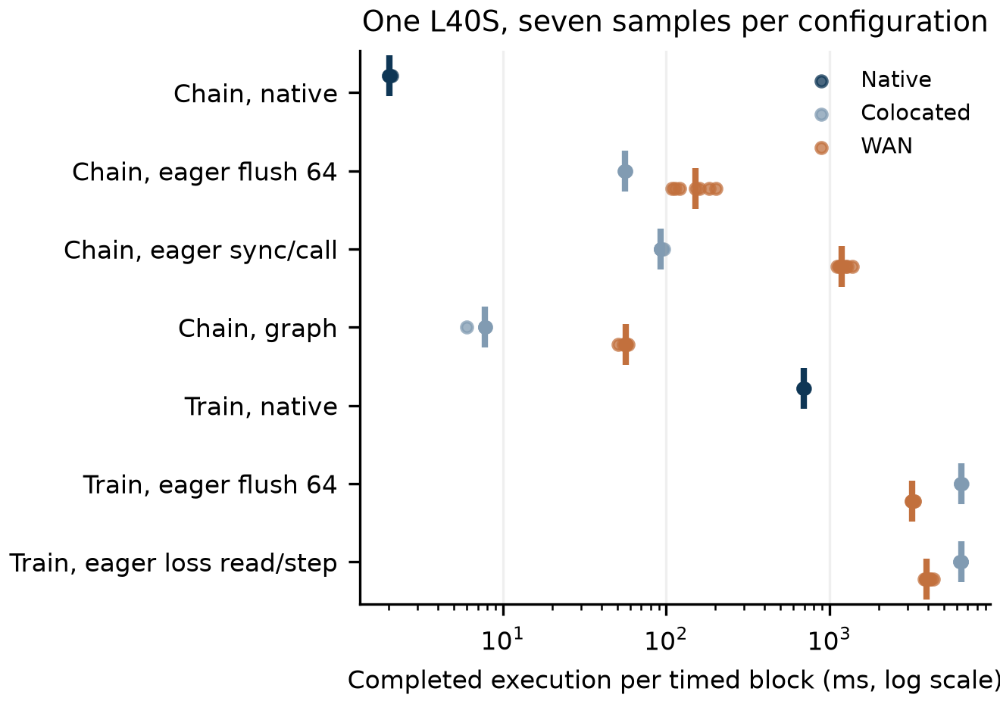

# rGPU: Streaming Remote GPU Execution Across CUDA and PyTorch Boundaries

Systems paper draft | October 15, 2026

## Abstract

Remote GPU execution separates application placement from accelerator placement, but fine-grained host-device interactions can turn a fast accelerator into a slow distributed system. rGPU explores this problem through two independent interfaces: a compatibility-oriented CUDA interception stack and a PyTorch device that forwards tensor operations while retaining application control on the client. The PyTorch path computes output metadata locally, assigns remote tensor identifiers before execution, and streams ordered operations without awaiting individual replies. Optional graph shipping moves repeated forward and backward computation to the server. Both paths distinguish a network connection from the longer-lived execution session. We explain the resulting performance and correctness tradeoffs, including synchronization, deferred errors, replay, and API compatibility. A CPU loopback experiment finds that graph shipping reduces 601 protocol messages to 41 and median completed execution from 45.42 ms to 2.07 ms for a small repeated computation, while remaining slower than native CPU execution. On one L40S, eager remoting of a transformer training step was 8.9x slower than native execution with a matched single-tensor optimizer, at about 6,500 logical protocol messages per step, and graph shipping the step reduced that to 3.0x. A follow-up experiment with pinned cores and injected latency found the client CPU-bound: eager time did not change with added round trip from 0 to 116 ms, while blocked time grew by about one round trip per wait. Those training results cover one GPU model, one model, and one batch size. The CUDA path now runs unchanged llama.cpp and stock Ollama with matching generated output in the tested cases. On an A40 with one CPU thread, buffered server reads and earlier queue flushes raised colocated llama.cpp generation from 105-121 to 210-217 tokens/s, against 379-390 native. Caching and upload-only queued synchronization reduced reply dependencies from 45 to one per token, but an earlier WAN run remained link-bound at about 3 tokens/s with 0.58 MiB of logits downloaded per token. These CUDA observations are recorded summaries, separate from the repeated training experiments. This is an implementation and characterization report: it does not propose a new remoting mechanism, and it does not establish near-native GPU performance or superiority over prior systems.

## 1. Introduction

GPU applications are often developed on machines different from those that provide the desired accelerator. Moving the entire application to a GPU server is straightforward when its data, dependencies, and control logic already belong there. It is less convenient when interactive state, development tools, or host-side integration belong on the client. GPU remoting offers another execution boundary: retain the host program locally and execute accelerator work elsewhere.

The difficult part is not sending an operation over a socket. It is preserving the application's expectations without making every operation wait for the network. GPU execution already separates submission from completion. A client can issue many operations whose results remain on the device before it needs a scalar, a downloaded tensor, or an explicit synchronization. A remote implementation that introduces a reply at every submission destroys this opportunity for overlap. Conversely, returning immediately creates obligations: output identities must exist before their values, failures must remain observable, and reconnecting must not execute a non-idempotent update twice.

rGPU implements two answers to this problem. Its CUDA path replaces supported driver, runtime, and mathematical-library entry points and forwards them to a server with the real CUDA stack. Its PyTorch path exposes an explicit `rgpu` device and forwards ATen operations. The latter has enough framework information to predict many output shapes and strides locally. It therefore returns a metadata-bearing tensor immediately, with the actual tensor retained by a remote session. Static graphs can be shipped once and invoked by identifier. These are separate protocols and execution paths, not stages of a single pipeline. [S1]

The central question of this paper is: **how do the interception boundary and the frequency of host-observable results determine the practicality of remote execution?** We use rGPU to examine that question rather than claim that API remoting, asynchronous submission, or framework-level execution is new. The most defensible contribution is a concrete implementation and characterization of their combination for client-resident programs. This paper is an implementation and characterization report; it does not answer the central question with a controlled comparison of the two boundaries, and it does not claim a new mechanism.

The paper contributes three things. First, it presents the design tradeoff between compatibility through CUDA interception and metadata-informed execution through PyTorch. Second, it explains the ordering and failure mechanisms required to make streaming useful, including bounded reconnect recovery, and states where the implementation's contracts are narrower than the design suggests. Third, it reports historical GPU observations, a reproducible CPU mechanism experiment, two same-GPU L40S experiments, one comparing eager remoting with native execution and one separating client, server, and network time, and subsequent CUDA inference observations, making the limits of each explicit. The evaluation deliberately includes negative results: compilation reduced messages but slowed a short historical training run, tiny operations remain much cheaper to execute locally, and eager remoting of a training step was 8.9x slower than native on the same GPU from a client on the server's host, limited by the client's own CPU.

The original source inspection used commit `7a8ba43`; this revision incorporates main through `ced62f5`, including the changes since the paper branch forked at `58a0fa5` (full hashes and provenance in Appendix A). Earlier measurements retain their original source and configuration rather than being attributed to the current implementation. The evaluation remains preliminary: the L40S training experiments measure the Python path, while the later CUDA observations cover one small inference model and do not constitute a matched comparison of the two boundaries. That comparison and a coarse-RPC baseline remain required in Section 7. [S1, S2, S9-S11]

## 2. Background and Prior Work

### 2.1. GPU remoting and the choice of boundary

GPU remoting interposes between an application and accelerator execution. A low boundary preserves more of the original software stack but exposes less application meaning. A high boundary can aggregate work and understand tensors or graphs, at the cost of a narrower programming interface. This choice is independent of the transport: TCP, RDMA, and shared memory can support different execution abstractions.

**rCUDA.** Pena et al. describe transparent CUDA sharing across HPC nodes, including communication optimizations and an InfiniBand implementation. Their evaluation moves from correctness and benchmarks to a production application and shared deployment scenarios. This work establishes remote CUDA access and pooled GPUs as prior art. rGPU's CUDA path belongs to this established family; its use of remote acceleration is not itself a novelty claim. The relevant distinction is the additional framework-level path and its operating assumptions. [1]

**Cricket.** Eiling et al. build an open CUDA virtualization layer supporting remote execution and checkpoint/restart. Their paper separates API virtualization from checkpointing and evaluates application performance, microbenchmarks, and state recovery. It also illustrates how frequent host-device exchanges can expose communication overhead. rGPU shares the API-interposition setting, but its reconnect protocol retains live server state rather than creating a durable checkpoint. A broken connection and a failed GPU server are different failure cases. [2]

**Singularity.** Shukla et al. describe a scheduler that transparently preempts deep-learning jobs, migrates them to other nodes, clusters, or regions, and resumes them from the point of preemption, with elastic resizing. That is relocation of execution state. rGPU's reconnect restores transport continuity to a live server session; it cannot move a session or recover one whose server is lost. [17]

**AvA.** Yu et al. generate accelerator virtualization components from API specifications and combine them with hypervisor-mediated resource control. AvA is particularly relevant to the engineering cost of a broad, evolving interface. rGPU also uses generated wrappers and annotations, but does not provide AvA's general accelerator specification system or hypervisor-enforced sharing policies. Generated entry points must not be equated with implemented semantics; rGPU has explicit unsupported stubs. [3]

**Tessera.** Hu et al. disaggregate large-model inference at the granularity of individual kernels, extracting inter-kernel dependencies from PTX and scheduling kernels across heterogeneous GPUs within a serving cluster. It is the finest-grained placement boundary in this survey, but it addresses a different problem: distributing one workload's kernels among several accelerators that are all near the serving host, not keeping a host program resident on a client that has none. Its relevance here is as a data point that kernel-level granularity is workable when the interconnect is a cluster fabric; it does not report client-resident execution over a WAN. [14]

### 2.2. Latency hiding and service-oriented disaggregation

**DGSF.** Fingler et al. specialize API remoting for serverless functions through resource pooling, latency-hiding optimizations, and GPU execution migration. Their evaluation separates the cost of remoting from the benefits of optimizations and consolidation. This distinction is directly useful here: a system can outperform a deployment baseline because of resource management while still imposing overhead on an otherwise identical execution. rGPU currently addresses remote execution and connection continuity, not serverless placement or migration across physical GPUs. [4]

**Network requirements for GPU API remoting.** Wang et al. make API requests outstanding rather than awaited, keep a client-side shadow of each remote resource so that queries can be answered locally and shadow identifiers mapped to real ones, compare this with request batching, and validate an RTT- and bandwidth-based cost model against RDMA measurements. rGPU's client-assigned tensor identifiers and locally predicted metadata are the same two principles applied at the ATen boundary. rGPU adds an implementation at that boundary over ordinary TCP and SSH, a separate CUDA implementation, and measurements of both; it does not add a new latency-hiding mechanism. [5]

**Torpor.** Yu et al. build a serverless inference platform that shares a node's GPUs among functions by swapping models onto GPUs on request, using asynchronous API redirection, GPU runtime sharing, and pipelined model execution. Asynchronous redirection there serves resource sharing within a node. rGPU attempts no sharing, model swapping, or pooling. [16]

**DxPU.** He et al. disaggregate GPUs at the PCIe transaction level, using proxy hardware and a performance model to guide implementation and evaluation. This offers a different compatibility tradeoff: preserving the software-facing device abstraction can require specialized infrastructure. rGPU instead uses software interfaces and ordinary stream sockets. It cannot inherit DxPU's hardware transparency, nor can results from their datacenter setup predict rGPU's behavior over a WAN. [6]

### 2.3. Framework semantics and graphs

**Prism.** Yang et al. partition deep-learning recommendation models into CPU- and GPU-intensive subgraphs and coordinate placement and RDMA communication at production scale. Prism illustrates what workload semantics can enable beyond individual API forwarding. Its native, colocated-disaggregation, and remote-disaggregation baselines are a useful template for isolating overhead. rGPU's graph shipping retains a graph on one server; it does not automatically partition a model or implement a topology-aware scheduler. [7]

**Genie.** Hong et al.'s HotNets paper, *Lost in Translation*, argues for framework-level accelerator disaggregation and proposes a semantically rich graph carrying execution and residency information. It overlaps rGPU at the mechanism level, not only in motivation: its prototype PyTorch frontend uses `__torch_dispatch__` to defer execution into LazyTensor proxies that capture dependencies and tensor properties, then applies an FX pass, and the paper evaluates the prototype on an LLM executed across a disaggregated network [8, Section 3.1 and evaluation]. rGPU's Python path uses the same interception point, a `__torch_dispatch__` tensor subclass carrying meta-derived properties, and FX graphs for shipping. The difference is in use rather than mechanism: rGPU executes intercepted operations in order and keeps the program resident on the client, while Genie builds an annotated graph for a scheduler to place by phase and residency, which rGPU does not implement. rGPU is not the implemented counterpart of a conceptual proposal, and it does not originate semantic disaggregation. [8]

**Kernel-as-a-Service.** Pemberton et al. run host code as ordinary serverless functions and execute graphs of GPU-only kernels as separately invoked serverless functions, implemented on Ray. The interface and setting differ from rGPU's device abstraction, but keeping host code separate while shipping GPU graphs for remote execution is not new. [15]

**PyTorch and PyTorch 2.** PyTorch's imperative execution and autograd provide the programming model rGPU seeks to retain. TorchDynamo and TorchInductor provide graph capture and compilation rather than components invented by rGPU. The rGPU backend connects this infrastructure to remote graph registration and invocation. Graph shipping and compiler optimization are separable: a shipped graph can execute eagerly on the server, which allows us to study granularity changes without kernel fusion. [9, 10]

**PyTorch RPC.** Li et al. provide tensor-aware RPC, remote references, and distributed autograd for explicitly distributed applications. These primitives solve a broader application-composition problem. rGPU instead presents device placement and operator dispatch as the integration boundary. A fair alternative for evaluation is a manually coarse-grained RPC that executes a complete step or model remotely, since it may avoid much of the fine-grained client overhead. [11]

**NotebookOS.** Carver et al. address interactive GPU use through replicated notebook kernels and on-demand resource allocation. This is an important alternative to forwarding individual operations: retain an interactive user experience while moving execution at a notebook boundary. rGPU's client-resident process offers a different integration choice, whose advantages should be evaluated against execution of the whole program remotely. We cite the revised NotebookOS preprint, not its withdrawn first version. [12]

### 2.4. Positioning and scope

Table 1 summarizes architectural distinctions, not benchmark rankings. Prior systems were not installed or measured in this study, and their published performance numbers use different hardware and workloads. No quantitative superiority claim is made. Given Wang et al., Genie, and Kernel-as-a-Service, rGPU's mechanisms individually have precedents; what this paper offers is two independent implementations for client-resident programs, a statement of their ordering, failure, and recovery contracts, and measurements of their cost.

| System | Main boundary | Relevant mechanism |
| --- | --- | --- |
| rCUDA | CUDA APIs | Remote GPU sharing |
| Cricket | CUDA APIs | Virtualization and checkpointing |
| AvA | Specified accelerator APIs | Generated virtualization and mediation |
| DGSF | CUDA APIs | Serverless pooling and migration |
| Torpor | GPU API calls | Asynchronous redirection and model swapping |
| KaaS | Graphs of GPU-only kernels | Serverless kernel invocation |
| DxPU | PCIe transactions | Hardware-assisted disaggregation |
| Prism | Model subgraphs | DLRM partitioning and scheduling |
| Genie | Framework graph | Semantic execution and residency |
| Tessera | Individual kernels (PTX) | Heterogeneous-GPU kernel placement within a cluster |
| rGPU CUDA | Supported CUDA/library calls | Batched submission and live sessions |
| rGPU PyTorch | ATen operations/graphs | Local metadata and streamed execution |

Table 1. Selected architectural relationships. Entries identify the focus discussed here rather than exhaustively enumerate each system's capabilities. [1-8, 14-16, S1]

The literature review also located the OSDI 2026 program entry for *Djinn: Transparent GPU Disaggregation with Semantic Awareness*. Only listing-level information was verified. On September 26, 2026 we attempted to obtain the full text through four independent routes - the USENIX presentation page (which refuses automated retrieval), the publications page of a listed coauthor's group, a third-party OSDI 2026 index, and searches restricted to arXiv, USENIX, ACM, and Semantic Scholar - and found no preprint or abstract. We therefore do not infer its mechanisms or results from the title. Its title alone suggests the closest positioning to the framework-level question studied here, so a technical comparison is a required step before submission and is recorded as such in Section 7, not treated as settled. [13]

## 3. Problem Statement and Performance Model

### 3.1. Goals and non-goals

rGPU aims to keep application control on a client, preserve supported tensor or CUDA behavior, and amortize network interactions over useful remote work. It should report unsupported behavior and lost execution state rather than silently continue with incorrect values. Clients may opt into the PyTorch device or use the Linux CUDA compatibility path.

The implementation is not a cluster scheduler, a durable checkpoint service, or a secure multi-tenant GPU platform. The two protocols have no built-in authentication or encryption. The intended deployment uses trusted access, normally SSH, and a server per trust domain. The CUDA listener additionally requires firewall restrictions because its default bind exposes all IPv4 interfaces. The Python server defaults to loopback. [S1]

### 3.2. Messages are not round trips

Let M denote the number of protocol messages, W the number of client operations awaiting a reply, B the bytes transferred, R the network round-trip time, and beta the effective transfer throughput. Distinguish these from F, the number of transport frames or writes. Batching reduces F; it need not reduce M or W. Graph shipping can reduce M; it need not reduce W. Eliminating a host observation can reduce W.

A simple accounting model is:

`T = T_start + T_host + T_remote + T_encode + T_transfer + T_wait + T_queue - T_overlap`.

Terms denote costs before subtracting their overlap, not independently measured components. Under approximately constant RTT, sequential non-overlapped reply dependencies suggest `T_wait,network ~= W * R`. This is a sensitivity estimate, not a complete latency predictor. An awaited reply may also include server queueing, outstanding compute, and response serialization. Conversely, work can have executed while the client prepared the request. Socket backpressure can stall submission without incrementing the explicit wait counter.

Similarly, `B / beta` describes transfer service demand under stable throughput, not necessarily added wall-clock time. Startup uploads, bursty traffic, directionality, SSH overhead, and bandwidth-delay effects require separate measurement. The presence of only a few waits therefore does not prove that the network is irrelevant.

### 3.3. When remoting can win

Against a weaker local accelerator, remote execution can win if the compute time saved exceeds client dispatch, communication, and synchronization costs. Against native execution on the same remote GPU, those costs must instead be hidden or offset by a demonstrated optimization. These are different research questions and require different baselines.

This model yields three testable expectations. Frequent host observations should increase sensitivity to RTT. Graph shipping should primarily reduce repeated client dispatch and encoding, with benefits dependent on compilation amortization. Small operations should often remain faster locally because remote execution has fixed costs even on loopback. Section 6 tests the mechanisms that can be measured with the available environment and distinguishes them from historical GPU evidence.

## 4. Design

### 4.1. Two independent execution paths

The PyTorch path places a dispatch layer under application-level tensor operations. A `RemoteTensor` carries local metadata and an identifier; the server owns its values. Requests travel to `rgpu-opserver`, which executes supported ATen operations on its configured CUDA, MPS, or CPU device. CPU and MPS backends are useful for development and controlled semantic checks.

The CUDA path exposes replacement libraries for the supported driver, runtime, cuBLAS, cuBLASLt, and cuDNN surfaces. Calls are serialized to a C++ server and executed through real CUDA libraries. Runtime calls include handwritten translation to driver operations; regular driver wrappers are generated. Library-loading details matter because an application's RPATH or absolute preloads can bypass an intended shim. This path targets Linux clients; a macOS deployment uses a Linux environment for CUDA binaries. [S1]



Figure 1. The interfaces share a design principle, not a wire protocol. Tensor values and accelerator handles remain server-side; the client retains application control and the information needed to name remote objects.

### 4.2. Predicting metadata before values

For an ordinary supported operation, the PyTorch dispatcher first runs the operation on meta tensors. These carry shape, dtype, stride, and storage-layout information without allocating the real result. If the output metadata is known, rGPU allocates identifiers locally, builds wrapper outputs, and queues a `RUN` message containing the operation name, overload, arguments, and output identifiers. The application can immediately construct another operation using those outputs. [S3]

For example, multiplying two suitably shaped remote tensors need not return the result's dimensions over the network: the meta kernel can infer them. The client therefore has enough information to express a subsequent activation or matrix multiplication even though neither operation has completed. This is more than socket batching; it removes a semantic dependency on a response.

Not every operation permits this treatment. A data-dependent output shape may require executing the operation on the server and returning output metadata through `RUN_SYNC`. Scalar extraction, downloading a tensor, and printing values also require a response. The implementation rejects several in-place metadata changes and unsupported combinations involving data-dependent output sizes and `out=` parameters. It does not pretend every PyTorch operator can execute asynchronously. [S3]

### 4.3. Identity, aliasing, and lifetime

Remote tensor identity is attached to the local meta tensor. This allows wrapper reconstruction and graph tracing to refer to the same remote object without moving its values. Schema alias annotations identify operations that return a written input rather than a new result. Views and layout metadata matter because subsequent operations must interpret the server-side object consistently with the wrapper.

The eager wrapper explicitly preserves conjugate and negative metadata bits. At the originally inspected commit, compiled-graph output reconstruction did not: it rebuilt output metadata from dtype, shape, stride, and offset only. A function compiled with the `rgpu` backend that returned a lazily conjugated or negated view of an intermediate, such as `(x * 2).conj()` or `(x * 2).conj().imag`, came back with the bit cleared: `is_conj()` was false where CPU execution reports true. This gap was found by an external review of this paper with a helper-level probe and then reproduced end to end against a CPU server. It was fixed after the original inspection in commit `c0318a3`, with three regression cases in `test_compile.py`; that fix is included in the current source snapshot and in the second L40S session. Neither benchmark uses complex tensors, so the reported measurements are unaffected. The synchronous-fallback reply of Section 4.2 likewise carries only dtype, shape, stride, and offset; no reachable wrong result has been demonstrated from it, but its metadata contract is narrower than the eager wrapper's. A dense non-contiguous tensor downloaded to the client has its layout reconstructed when appropriate. Metadata correctness is thus not cosmetic: a missing conjugation bit can change how higher-level PyTorch operations interpret a tensor before the remote dispatcher is reached. [S3, S5]

Weak-reference finalizers enqueue dead identifiers in a pending-free list. A later safe queueing point combines those identifiers into a `FREE` message. Finalizers therefore do not perform network I/O directly. Server-side release follows protocol ordering, so an object is not freed ahead of an earlier queued operation that uses it. Delayed frees also explain why a message count can exceed the number of arithmetic operations. Throughout this paper, M counts logical protocol messages queued by the client, including `FREE`, acknowledgement, and other control messages; it is not a count of GPU operators or kernel launches. Byte counters report protocol payload and exclude frame-length headers and TCP or SSH overhead.

### 4.4. Streaming, batching, and acknowledgements

The Python client uses one connection per process, protected by a reentrant lock because autograd may issue work from another thread. Pending operations are encoded before being committed to the sequence. The default flush thresholds are 64 messages or 256 KiB of encoded pending data. A request that needs an answer flushes preceding operations first. Crossing a flush threshold sends a batch but does not by itself require a reply. There is no periodic sender: a tail below both thresholds stays buffered until a later flush or waited request, so ordering is guaranteed but prompt progress and overlap are not. [S4]

This ordering lets the server execute `produce A`, `consume A to produce B`, and `download B` correctly without separate responses for the first two messages. Metadata prediction makes the first two submissions possible; the ordered session makes their execution meaningful. The client may still stall on encoding, locks, or socket writes, so asynchronous submission does not imply unlimited parallelism.

Protocol acknowledgement and GPU completion are distinct. An `ACK` confirms progress through the operation stream and permits retained replay data to be released. A `SYNC` additionally waits for the configured device. Confusing these would either introduce unnecessary device stalls or report incomplete work as finished.

The CUDA path separately caches device properties and per-kernel occupancy results. Property attributes are fetched in one bulk call, with a per-attribute fallback for older servers; occupancy answers are keyed by device, block size, dynamic shared memory, and flags and retained with the registered kernel. These caches remove repeated queries without changing the application's launches. Accurate properties also affect numerical behavior: the earlier omission of the opt-in shared-memory limit made llama.cpp choose a different quantized matrix-multiplication path. [S9, S10]

CUDA stream synchronization has a narrower default contract than an unconditional completion barrier. With `RGPU_LAZY_SYNC` unset, a synchronize following only uploads on its stream is queued and returns immediately: the client has already copied the upload bytes, and the server still executes the synchronize in order. A synchronize following other GPU work waits. Work whose stream cannot be identified conservatively counts against every stream. An upload failure can consequently surface at the next waited call rather than at that synchronize. Setting `RGPU_LAZY_SYNC=0` makes every stream synchronize wait; setting it to `1` queues every stream synchronize, even after kernels, and therefore cannot be used to time their completion. Context and device synchronizes always wait. [S9, S10]

The C++ transport sends a frame's header and payload together with a scatter/gather write, retrying short writes. The server reads frames through a 64 KiB buffer. The client now flushes queued calls every 1 KiB, configurable with `RGPU_FLUSH_BYTES`, so remote execution can begin while the application is still issuing launches. This threshold was previously 256 KiB; it is independent of the Python path's unchanged 256 KiB byte threshold. The two paths share the setting name, but use different defaults. Flushing adds writes without adding replies. Section 6.10 separates the observed gains from these transport changes from the reduction in reply dependencies. [S9, S10]

### 4.5. Graph shipping

rGPU integrates with AOTAutograd to obtain forward and backward ATen graphs. It serializes allowed graph nodes, registers them through `COMPILE`, and later sends `CALL` messages with graph and tensor identifiers. The server reconstructs an FX graph and either executes it eagerly or applies Inductor. The normal user-facing backend is selected explicitly with `torch.compile(model, backend="rgpu", dynamic=False)`. [S5]

Output metadata obtained during tracing again allows calls to stream without fetching shapes. Shipping a graph changes communication granularity: intermediates internal to the graph no longer require an individual client dispatch and remote identifier exchange at every operation. It does not necessarily eliminate the application's scalar reads or input transfers.

The supported compiled path assumes fixed shapes. Some unshippable graphs fall back to eager remote execution with a warning. Non-ATen custom operators are rejected because neither execution path in the Python server can resolve them. Graph registrations are session-scoped: `FREE` releases tensors but not registered graphs, so repeated recompilation in a long-lived session accumulates graph entries until the session ends. A bare `torch.compile` selects a different backend and is not a transparent substitute. Graph registration, tracing, compilation, and warm execution must be measured separately; reduced message traffic does not guarantee a lower total runtime.

### 4.6. Deferred failures

An asynchronous operation cannot report its execution failure through an already-returned call. In the Python server, a failed operation records its first error and places poison objects in the expected output slots. A dependent operation encountering poisoned input skips execution and propagates poison. A later waited request reports the original failure instead of presenting a cascade of missing-tensor errors. [S6]

Two cases are narrower. An in-place operation returns its written input rather than a new output identifier, so when it fails, that input is not poisoned: later operations on it run against whatever state the failure left, before any observation reports the error. And a waited request that surfaces a deferred error reports that error instead of executing, so a `SYNC` that raises a deferred error has not completed the device barrier; only a successful `SYNC` does.

This is an error-propagation mechanism, not a transaction system. It does not roll back operations that completed earlier, and it cannot promise recovery from arbitrary partial device failure. It preserves a useful diagnostic relationship between the failing operation and a later observation point.

In the CUDA path, requests carry the issuing client thread's identity. The server tracks that thread's context stack, stream-capture mode, and deferred asynchronous error. The error belongs to the session's thread state rather than a particular socket, so a reconnect does not simply discard it. Maintaining per-thread context semantics requires more than serializing all requests through one server thread. [S7]

### 4.7. Reconnection without restarting the computation

The Python handshake identifies a session independently of its TCP connection. Each operation has a monotonically increasing sequence number; the server records the latest applied sequence and caches the latest reply. After a connection loss, the client reconciles progress and replays retained operations that the server has not applied. Duplicate sequences are suppressed. Attach generations prevent an obsolete connection from continuing to mutate a session after a newer connection takes ownership. [S4, S6]

Recovery is bounded. The Python client retains at most 64 MiB of unacknowledged encoded operations and requests acknowledgement near a 48 MiB threshold when applicable. A single oversized request can exceed the cap and temporarily make replay unavailable. Detached sessions normally expire after 120 seconds. The client's reconnect retry loop has a default 60-second budget; this is not an end-to-end detection or recovery bound, because the deadline is checked between attempts and a single connect (10-second default timeout) or receive (300-second default) can overrun it. If the server has lost the session, the client raises `SessionLost` instead of creating an empty replacement behind still-live tensor references.

The guarantee is consequently conditional: duplicate suppression and ordered replay address transport interruption while the server process and required session state survive. There is no durable log committing device effects atomically with protocol progress, no restart reconstruction of lost GPU memory, and no general exactly-once guarantee across a server crash. The C++ path implements an analogous live-session approach using its own protocol and request numbering. It should not be described as sharing the Python wire format, and its replay contract differs: once its unacknowledged data exceeds a 64 MiB cap it disables replay with no later reset, whereas the Python client re-enables replay once the server has acknowledged everything outstanding; and a waited C++ call gets two transport attempts before it is abandoned with an error, leaving its effect on the server uncertain. [S7]

## 5. Implementation and Supported Semantics

The implementation divides naturally into Python tensor dispatch, Python session transport, server operation execution, graph serialization, C++ CUDA shims, and generated driver dispatch. The artifact appendix maps each claim to source files. Handwritten annotations and library wrappers supply semantics that cannot be inferred merely from a C signature. An exported symbol or generated weak stub is not evidence that its operation works. [S1, S8]

The Python protocol carries structured values and named ATen operations rather than arbitrary Python callables. Graph reconstruction uses the same operation-resolution boundary. This reduces the surface needed to represent a computation but does not make the server safe for untrusted tenants. Expensive allocations and kernels still consume resources, and authentication, authorization, quotas, and robust isolation are outside the demonstrated system.

Version matching is checked at the PyTorch major/minor level because client and server operation schemas must agree. A mismatch override exists for experiments. It is an escape hatch, not a compatibility proof. Moving a model to `rgpu` before constructing a live grad-tracking execution is also significant: parameter swapping can fail when an earlier autograd graph still retains the original parameters. [S1, S3, S4]

The CUDA path does not support managed memory or network-transparent zero-copy host mappings. Generated stubs for unimplemented entry points return an unsupported error. Some compatibility entry points are instead intentional no-ops that return success: the two runtime profiler calls, and host-memory registration and unregistration without the device-map flag (with the flag, they return unsupported). Symbol coverage is therefore not semantic transparency. Fake-driver tests can validate serialization, dispatch, and protocol behavior; they cannot establish that real CUDA synchronization, kernel execution, or every library version is supported. The repository's JAX work remains experimental and is outside this paper's measured scope. [S1]

The CUDA implementation now forwards virtual memory reservation, allocation, mapping, access control, queries, and release, including `cuMemAddressReserve`, `cuMemCreate`, and `cuMemMap`. Session inventory tracks mappings, allocation handles, and reserved ranges separately, because these resources are not owned by a CUDA context. On expiry it unmaps first, releases outstanding handles, and then frees address ranges; mappings must be tracked even when the client releases a handle immediately after mapping it. This supports llama.cpp's allocation pattern. It does not implement cross-process export of shareable memory handles. cuBLAS status names and strings are answered locally, and the runtime PCI bus identifier reflects the server GPU. [S9, S10]

Unchanged llama.cpp and stock Ollama now run through these shims. The verified Linux x86_64 launcher uses `rgpu ollama serve` with `OLLAMA_LLM_LIBRARY=cuda_v12` and `GGML_CUDA_DISABLE_GRAPHS=1`; it preloads the shims into Ollama's subprocesses without replacing installed libraries. Disabling CUDA graphs remains required because `cudaGraphExecUpdate` is unsupported. The server loads the real math libraries and is started directly, not through the client launcher. Support remains bounded to the tested CUDA 12 shared-library path and supported calls, rather than arbitrary CUDA binaries. [S9]

Finally, ordering within one session is not isolation between sessions. In the Python server, seeding uses process-global PyTorch RNG state, so concurrent sessions can interfere with random-number sequences. In the CUDA implementation, context ownership and sharing impose additional trust-domain constraints. These limitations rule out claims of transparent hostile multi-tenancy.

**Native CUDA and rGPU in one process.** A process that has imported rGPU cannot run `backward()` on a local CUDA or MPS device: PyTorch's autograd engine fails an internal assertion. The cause is in PyTorch, not rGPU. Naming a custom backend makes it the process's accelerator, and the engine then finds no stream for gradients on any other accelerator. Registering the backend under a name is enough to trigger it, with no rGPU code involved; it is reported upstream as PyTorch issue 161129 and affects PyTorch 2.8 and later. Programs that train on both devices must use separate processes, as the experiments of Section 6.9 do.

## 6. Performance Evaluation

### 6.1. Questions, provenance, and methodology

The evaluation asks four questions: can useful work amortize remote interaction; which costs are reduced by batching and graph shipping; when does host observation become expensive; and what does recovery testing establish? We keep five evidence classes distinct.

**Historical GPU observations (H).** The repository records September 13-14, 2026 experiments using an Apple M3 client and, where specified, a rented NVIDIA A40 reached through SSH. These are single-run summaries rather than archived per-trial datasets. Exact workload scripts and a benchmark commit are not pinned in the record. We preserve their caveats and do not attach confidence intervals to them. [S2]

**Fresh CPU measurements (F).** We ran the accompanying `benchmark.py` on the inspected checkout using Python 3.14.7 and PyTorch 2.14.0 on macOS 26.5 arm64. Client and server are separate processes on the same host, communicating over TCP loopback. The client uses one Torch CPU thread; server environment variables set OpenMP and MKL thread counts to one. No usable CUDA or MPS device was exposed to this run. Host contention and power state were not controlled. This experiment measures software overhead, not GPU speed or WAN latency tolerance.

**Analytical estimates (A).** Arithmetic using recorded RTT, counters, or byte counts is marked as such. These estimates are neither measured network decompositions nor additional workload runs.

**Same-GPU measurements (G).** Two sessions on rented NVIDIA L40S pods, each a separate rental and so possibly a different physical host. The first, on September 26, 2026 with `gpu_benchmark.py`, ran native, colocated over loopback, and from a laptop through an ssh tunnel (Section 6.8). The second, on September 27, 2026 with `gpu_experiments.py`, pinned client and server to disjoint cores, injected latency with a loopback proxy, matched the optimizer, shipped the training step as a graph, and compared training state against native (Section 6.9). Ratios within a session use that session's own native baseline. These are seven-trial medians with ranges on shared cloud hosts, on a different GPU and link from the historical record, and are never combined with H. Arithmetic on G numbers is labelled A on G.

**Subsequent CUDA observations (C).** October implementation commits and current documentation record llama.cpp and Ollama inference, WAN behavior, and fake-driver measurements. The companion measurement note records the maintainer-supplied A40 ranges and CPU-throttling observations for this revision. These are reported observations, not new runs made for this revision or seven-trial datasets like G. Section 6.10 identifies the platform and source of each result; missing raw samples, exact run commands, and per-run build identifiers remain provenance gaps. Fake-driver timings do not measure GPU computation. [S9-S11]

### 6.2. A historical remote training case

The recorded workload is a 10.8-million-parameter, six-layer, six-head transformer with embedding width 384, batch size 64, sequence length 256, and 20 eager training iterations. It is a modified `yangpt` build-along workload, not the later pinned tutorial script. Both configurations use rGPU's Python device. [S2]

| Metric | Local MPS server | Remote A40 server |
| --- | --- | --- |
| Training loop | 60.8 s | 20.8 s |
| Time per iteration | 3.04 s | 1.04 s |
| Recorded messages | 139,931 | 139,931 |
| Recorded waits | 5 | 5 |
| Outgoing volume | 70.9 MB | 70.9 MB |
| Link | Loopback | Reported 116 ms RTT |

Table 2. Historical deployment comparison (H), one run per configuration. Traffic counters span the recorded run and are not proven to use exactly the training-loop timing window. MB follows the source's reported units.

The loop-time ratio is `60.8 / 20.8 = 2.92`. The result demonstrates that this remote deployment completed the recorded training loop faster than this local deployment. It does not show a 2.92x improvement over native A40 execution, nor quantify the price of remoting on the A40. The remote server ran Torch 2.11 while the client ran 2.14 with the mismatch override enabled, outside the normal matching-version configuration.

The recorded five waits are consistent with avoiding a reply per operation. Multiplying five by 116 ms gives 0.58 s (A), but this is not a measured fraction of the 20.8 s loop: wait durations include more than propagation, and the counter and timing scopes are not established as identical. It would be incorrect to attribute the remaining time to GPU compute alone.

The historical note reports equal initial losses to four decimal places and small later divergence between devices. This supports a limited numerical observation, not bitwise equivalence or long-run convergence. A native-MPS attempt was recorded as failing in autograd; it therefore supplies no valid native-MPS timing baseline. [S2]

### 6.3. Graph shipping: a useful negative result

A separate historical run used the same model family with batch 8, sequence length 64, and a local MPS server. Twenty eager iterations were compared with rGPU graph compilation. [S2]

| Metric | Eager | Graph shipped |
| --- | --- | --- |
| Messages | 139,931 | 44,880 |
| Total volume | 55.7 MB | 48.0 MB |
| Operation-stream volume | 12.5 MB | 4.8 MB |
| Training loop | 7.2 s | 8.3 s |

Table 3. Historical graph-shipping comparison (H). The record subtracts a 43.2 MB initial weight upload when reporting operation-stream volume.

Graph shipping reduced messages by 3.12x and operation-stream bytes by 2.60x, while total volume fell by only 1.16x. The measured loop was 15.3% slower. This is a stronger evaluation result than simply reporting communication reduction: compilation and execution overhead can outweigh savings in a short workload.

If graph execution adds setup cost C and saves d seconds per iteration after warming, its simple break-even point is `n > C / d`, provided d is positive. These two aggregate timings do not identify C or d. They cannot establish that a longer run necessarily crosses over, and no empirical break-even iteration count is available.

### 6.4. Fresh mechanism experiment on CPU loopback

The new workload applies ten repetitions of `x = x * 1.001 + 0.01` to a 1,024-element float32 vector. Each timed block makes 20 calls using the same input, for 400 arithmetic operations. Seven trials randomize the order of five configurations using a fixed seed. Each configuration receives two warmup calls. Remote blocks end with a device synchronization; downloads and numerical comparisons occur outside the timed interval. The benchmark asserts agreement with native output and expected wait counts.

The graph configuration uses `compiler="eager"` on the server. It therefore tests shipping and invoking a graph without Inductor fusion. Warmup excludes tracing and graph registration from the reported timed block. This is deliberately different from the short historical training comparison.

| Configuration | Median ms | Min-max ms | M | W |
| --- | --- | --- | --- | --- |
| Native CPU | 0.663 | 0.584-1.354 | 0 | 0 |
| Eager, flush 1 | 51.560 | 42.232-168.917 | 601 | 1 |
| Eager, flush 64 | 45.421 | 38.362-62.474 | 601 | 1 |
| Eager, sync each call | 68.554 | 50.223-129.562 | 621 | 21 |
| Graph, server eager | 2.065 | 1.860-31.840 | 41 | 1 |

Table 4. Fresh completed-work CPU-loopback measurements (F). All times cover 20 calls. M and W are median protocol message and wait counts over seven trials; M counts logical queued messages including `FREE` and control messages, not GPU operators or launches. Ranges expose observed variability; they are not confidence intervals.



Figure 2. All seven samples and medians on a logarithmic time axis. This is a CPU software-path experiment, not a GPU benchmark. Several large outliers make precise tail claims inappropriate.

**Batching is not reply elimination.** Both eager flush settings perform one final wait and send 601 messages. The 64-message setting lowers median time from 51.56 to 45.42 ms, a ratio of about 1.1, and outgoing protocol payload volume from 47,228 to 45,273 bytes. Changing the flush threshold does not turn each eager operation into a round trip. Counts include lifetime management and synchronization, so M is not the arithmetic-operation count.

**Host observations matter independently.** Synchronizing after each call adds 20 explicit waits and changes median time to 68.55 ms, about 1.5x the default eager median. This does not estimate an actual network RTT: it changes completion barriers and overlap on a shared local host. It does show that observation frequency is a separate control from batching.

**Graph shipping reduces per-operation work as well as bytes.** The graph configuration uses 41 messages versus 601, about a 15x reduction. Outgoing protocol payload bytes fall from 45,273 to 1,968, about 23x. Median time falls by about 22x. Ratios are given to two significant figures: they come from seven trials on a shared host, and the re-run recorded in Appendix A moved the time ratio by several percent while leaving the message and byte counts unchanged. These quantities differ because eliminating per-operation work - client dispatch, metadata prediction, and encoding, and server decoding and dispatch - can matter even when the wait count stays at one; this experiment does not separate client from server work. No GPU kernel optimization is necessary for this mechanism to help.

**Local execution is still best for tiny work.** Native CPU execution takes 0.663 ms. Graph shipping remains about 3.1x slower, while default eager remoting is about 68x slower. This is a relevant counterexample to any universal acceleration claim. The experiment also does not isolate transport cost from metadata dispatch, serialization, server dispatch, process scheduling, or lost local optimization opportunities.

### 6.5. Synchronization sensitivity

Table 5 evaluates the network-wait term `W * R` for a hypothetical 20-step run. Each row specifies a different total number of sequential reply dependencies. The calculation assumes no overlap of those dependencies and constant RTT; it omits all compute and bandwidth costs.

| Total waits W | R = 1 ms | R = 10 ms | R = 116 ms |
| --- | --- | --- | --- |
| 5 | 0.005 s | 0.05 s | 0.58 s |
| 20 | 0.020 s | 0.20 s | 2.32 s |
| 200 | 0.200 s | 2.00 s | 23.20 s |
| 20,000 | 20.000 s | 200.00 s | 2,320.00 s |

Table 5. Analytical sensitivity (A), not measured performance. The five-wait row uses the historical count as an illustrative input; the other rows are hypothetical.

This calculation explains why logging, data-dependent control flow, and host-side sampling deserve explicit treatment in a WAN evaluation. An autoregressive loop that requires a downloaded token before forming its next request can expose a dependency every token. Graph shipping cannot remove such a dependency unless more of the loop or sampling logic moves to the server. A low-wait training result therefore cannot be generalized to interactive generation.

### 6.6. Transfer composition and CUDA batching

The historical record divides 70.9 MB of outgoing data into 43.2 MB of initial float32 weights, 5.2 MB of integer token batches, and 22.5 MB of operation traffic. Offline zlib level-1 compression measurements report ratios of 1.08x, 5.38x, and 10.12x respectively, with compression speeds of 45, 268, and 612 MB/s. These are measurements of those payloads, not a deployed compressed transport. [S2]

Weight data dominate startup volume but compress poorly in this example. Operation descriptions are repetitive and compress more effectively. Nevertheless, compression is useful only if transfer savings exceed CPU and buffering costs. For payload size B, compression throughput c, ratio q, and link throughput beta, an approximate serial break-even condition ignoring decompression is `1/c < (1 - 1/q)/beta`. For the recorded weights this implies beta below about 3.33 MB/s; for the operation stream, about 551.5 MB/s (A). These are optimistic conditional thresholds, not recommendations independent of workload.

The record draws four conclusions from these payloads, and we keep them as the record's conclusions about those payloads, not as results about a deployed transport, which does not exist. Floating-point tensor buffers should not be compressed: at 1.08x and 45 MB/s, compressing the 43.2 MB of weights costs about a second of CPU to save about 3 MB. The operation stream is the compressible part, because it repeats the same operator names and structure thousands of times per iteration. The integer token batches compress only because eight bytes carry values below 65, which is a case for a narrower wire dtype, not for compression; likewise a lower-precision float format, where the model permits it, would reduce the weight upload far more than 1.08x. And compression is a complement to graph shipping, not a substitute: the record's graph-shipped run cut operation-stream bytes 2.6x, from 12.5 to 4.8 MB, and what remains is still the most compressible payload. [S2]

Whether any of this is worth deploying depends on which side is the constraint. In the historical run the client sent about 1.3 MB/s, so bandwidth was not the bottleneck. Section 6.9 adds a direct measurement on a different GPU: during eager training the client process was CPU-bound, with about 5.6 MB of outgoing payload per ten steps. Compressing the operation stream would add work to that client. It would pay only on a link thin enough for the stream's bytes to bound throughput, which no experiment here exercised, and for a one-time bulk upload the better lever is the wire format. Any such change needs a negotiated protocol flag on both ends.

A separate older RTX 3090 loopback measurement reports 2,000 kernel launches: 20.3 microseconds per launch without batching versus 3.2 microseconds with batching including the final synchronization, a 6.34x ratio. Submission-only timing was 0.2 microseconds. The completed-work number is the relevant comparison; the smaller value does not show how quickly the kernels finished. The record lacks repeated samples and a pinned benchmark build, and the CUDA result cannot be merged into the Python WAN result. [S2]

### 6.7. Correctness and recovery checks

We ran four existing Python test modules covering compilation, reconnect behavior, complex tensors, and training. All 40 selected tests passed in 42.54 s against a CPU server. The run emitted one warning about the wrapper lacking a stable hash for AOTAutograd caching. Tests include training through a connection drop, detecting session loss after server restart, matching optimizer updates with CPU references, and checking conjugation behavior. The complete command and output are included in the artifact. After the compiled-output metadata fix described in Section 4.3, the same four modules pass with 43 tests; that run postdates the original inspection, and `checks.txt` records the 40-test run.

These checks strengthen the evidence for specific execution and recovery paths. They do not prove all operator semantics, numerical equivalence on CUDA, crash consistency, or real-GPU thread-context correctness. Recovery time under realistic outage distributions was not measured. The historical tunnel-interruption observation is accordingly not promoted to a reliability guarantee.

The later CUDA evidence includes real-GPU checks, distinct from those CPU and fake-driver tests. The repository reports that `tests/hw/cublas_check.cu` and `cudnn_check.cu` pass through the shims: `tests/hw/math_check.sh` runs each natively and remotely and compares results with CPU references. Coverage includes runtime launches, cuBLAS and cuBLASLt GEMMs, cuDNN backend-graph convolution, and batch normalization. The VMM smoke test additionally checks serialization and session-expiry cleanup with a fake driver, and the inference record reports memory release after a killed client's session expires. These are specific compatibility checks, not exhaustive CUDA conformance or a new hardware run in this revision. [S9-S11]

### 6.8. Same-GPU experiment (G)

This experiment compares rGPU with native execution on one GPU, which the historical and CPU experiments could not. It was run on September 26, 2026 with `gpu_benchmark.py`. It holds the GPU, model, inputs, and numerical precision fixed. It does not hold the client CPU, client software, or optimizer implementation fixed, as described below.

**Setup.** One NVIDIA L40S (46 GB, driver 580.159.03) rented from a cloud provider; the host reported 256 cores, which is not evidence of 256 uncontended cores. The host ran Linux, Python 3.10.12, and torch 2.14.0+cu130; the WAN client ran macOS 26.5, Python 3.14.7, and torch 2.14.0. The PyTorch release matches, so unlike Section 6.2 there is no schema-version mismatch and no override, but the client software is not identical. TF32 was disabled natively to match the server's default. Two workloads: the 1,024-element elementwise chain of Section 6.4, 20 calls per timed block; and a training step of the transformer defined in `gpu_benchmark.py` (10.8M parameters, batch 64, block 256, dropout 0.2, AdamW at learning rate 3e-3), 10 steps per timed block, on one token batch uploaded before timing. Each timed block is preceded by two warmup chain calls or two warmup training steps and bracketed by a device barrier. On rGPU the barrier is `torch.rgpu.synchronize()`, whose server handler calls `torch.cuda.synchronize()`, so remote timings include GPU completion.

**Order and repetition.** Placement order was fixed: native, then colocated, then WAN. Within a placement, the configurations of each workload were shuffled in each of seven trials with a fixed seed, and all chain trials ran before all training trials. All seven trials of a leg share one client process and, for the remote legs, one rGPU session; they are repeated blocks within a run, not independent deployment repetitions. The artifact holds 84 G samples: 14 native, 35 colocated, and 35 WAN.

**Placements.** **Native** runs PyTorch on the L40S with rGPU absent. **Colocated** runs the rGPU client and server on the same host over loopback, sharing the host's AMD EPYC 9554, so no off-host link is involved; loopback transport and scheduling still cost something. **WAN** runs the client on an Apple M3 laptop, reaching the same server through an ssh tunnel, not bare TCP, at a measured 48.8 ms median TCP round trip (min 46.3, max 60.6 over nine samples). This is a different link and a different GPU from Section 6.2, and the two are not compared. Because the two rGPU placements use different client CPUs, a single-thread microbenchmark of ordinary PyTorch dispatch (20,000 one-element `torch.add` calls on CPU tensors, median of five) was run on both: 1.23 us per call on the EPYC, 0.53 us on the M3. It measures ordinary CPU-tensor dispatch, not rGPU dispatch.

**Optimizer path.** The benchmark constructs AdamW at learning rate 3e-3 and leaves `foreach` and `fused` unspecified. PyTorch then selects its multi-tensor `foreach` implementation only if every parameter's exact type is `torch.Tensor` or `nn.Parameter` on a supported device. rGPU parameters are a `RemoteTensor` subclass and fail that check: a local socket-free probe at the originally inspected commit returned no `fused` and no `foreach` for them, so rGPU ran the single-tensor AdamW path. That native CUDA parameters take the `foreach` path followed from reading the PyTorch source in this session and was confirmed on a GPU in the next (Section 6.9), where the matched single-tensor baseline was 3% slower than the default. Native and rGPU therefore did not execute the same optimizer implementation. The training ratios below are user-visible slowdowns against native defaults and remain valid as such; they are not a measure of transport and metadata overhead under an identical execution path, and part of the message count per step reflects the single-tensor optimizer path.

**Numerical check.** Before timing, one eval-mode forward pass with dropout 0 on a fixed batch was compared against a CPU reference within rtol = atol = 1e-4. The losses agree to that tolerance, not bitwise: 4.337957382 on the device in all three legs, against a CPU reference of 4.337957859 on the host and 4.337956905 on the laptop. Timed training uses dropout 0.2 and AdamW, and its only check is that the final loss is finite and below 10. This is a forward sanity check. It does not validate gradients, parameter updates, or optimizer state; Section 6.9 compares those.

| Workload / configuration | Native | Colocated | WAN (ssh, 48.8 ms) | M | W |
| --- | --- | --- | --- | --- | --- |
| Chain, native | 2.02 | - | - | 0 | 0 |
| Chain, eager flush 64 | - | 55.74 | 150.47 | 601 | 1 |
| Chain, eager sync each call | - | 92.72 | 1194.06 | 621 | 21 |
| Chain, graph (server eager) | - | 7.78 | 56.39 | 41 | 1 |
| Train, native | 698.98 | - | - | 0 | 0 |
| Train, eager flush 64 | - | 6399.59 | 3214.55 | 64,941 | 1 |
| Train, eager loss read each step | - | 6400.36 | 3931.33 | 64,951 | 11 |

Table 6. Same-GPU measurements (G): median milliseconds per timed block over seven trials, where a chain block is 20 calls and a training block is 10 steps. M and W are median message and wait counts per block for the rGPU configurations; native has no protocol. M counts logical queued messages including `FREE` and control messages, not GPU operators or launches. "Sync each call" is an explicit device synchronize; "loss read each step" is a `loss.item()` download, not a device-wide synchronize. WAN ranges: chain eager 108.70-202.57, chain sync 1116.93-1384.36, chain graph 50.67-58.12, train eager 3159-3321, train loss read 3805-4345. Colocated ranges: chain eager 55.37-56.60, chain sync 92.22-96.53, chain graph 6.01-7.80, train eager 6363-6472, train loss read 6267-6460. Native ranges: chain 1.99-2.07, train 689-701.



Figure 3. All seven samples and medians per configuration on one L40S, logarithmic time axis. Chain rows are 20-call blocks and training rows are 10-step blocks; do not compare across workloads. Native has no protocol. The two rGPU placements differ in client CPU, operating system, Python version, and host sharing as well as link, so their difference is not a network cost.

**Eager remoting is much slower than native on the same GPU.** Colocated eager training takes 9.2x the native time with one wait per block and no off-host link. Part of that ratio reflects the different AdamW implementation. A training step generates about 6,500 logical protocol messages. Dividing the excess elapsed time over native, about 570 ms per step, by those messages gives about 90 microseconds per message (A on G). That quotient is aggregate excess elapsed time per message: it includes client dispatch, metadata prediction, and serialization, server decoding and dispatch, loopback transport, scheduling, and the optimizer difference. It is not a measured client dispatch time. On the chain, colocated eager remoting is 27.5x native, against 68x on CPU in Section 6.4. Native GPU execution of the tiny chain is itself slower than native CPU execution (2.02 against 0.66 ms); the two ratios come from different experiments and are not decomposed against each other.

**Graph shipping reduces the chain overhead.** Shipping the chain as a graph brings colocated time from 55.74 to 7.78 ms, 3.8x native rather than 27.5x, with 41 messages instead of 601. This is consistent with the CPU result. It does not localize the removed overhead to the client: graph shipping also removes per-operation server decoding, argument reconstruction, and identifier bookkeeping. Graph shipping was not applied to the training step in this session; Section 6.9 measures it.

**Host observations cost time even on loopback.** In the colocated chain, synchronizing after each call raised the median from 55.74 to 92.72 ms for 20 extra waits, about 1.8 ms per added wait (A on G). In colocated training, reading the loss every step changed the median by 0.77 ms (6400.36 against 6399.59 ms) while raising the wait count from 1 to 11. That difference is far below the run-to-run variation, whose ranges span about 108 and 194 ms for the two configurations, so it does not show that the reads cost nothing. Through the WAN tunnel, the same ten reads added 717 ms to the median (3931.33 against 3214.55), about 72 ms each (A on G). That exceeds the measured median round trip by about 23 ms; the remainder is not decomposed.

**WAN placement: observations.** Graph shipping of the chain took 56.39 ms through the tunnel against 7.78 ms colocated, a difference of 48.6 ms, close to the measured median round trip. The synchronizing chain took 1194.06 ms with 21 waits against 150.47 ms with 1 wait, 52 ms per additional wait, also close to it. Both are differences of medians, the first across placements with different clients (A on G); neither is a measured per-wait latency. The eager chain took 150.47 ms through the tunnel, with a wide 108.70-202.57 ms range, against 55.74 ms colocated. The residual beyond one round trip is not explained by these measurements.

**WAN placement: the training result is not explained by this session.** Eager training through the WAN tunnel took 3214.55 ms, about half the colocated 6399.59 ms (2.0x), with the same 64,941 messages and the same median 5,569,105 outgoing payload bytes. The dispatch microbenchmark puts the M3 at 2.3x the EPYC per ordinary `torch.add`. The agreement is consistent with the hypothesis that client-side per-operation work dominates eager training and that a faster client can absorb the added link cost. It does not establish that hypothesis. Between the two placements, the client CPU, operating system, Python version, and client/server colocation all change together with the link, and the legs ran at different times in different processes. Alternatives the data do not exclude include contention between the colocated client and server for the host's CPUs, caches, or memory bandwidth; server-side decoding and dispatch cost that changes when the client leaves the host; NUMA placement, CPU frequency, or container CPU-quota effects; Python runtime differences; and time-varying load on the shared host. The microbenchmark does not measure rGPU dispatch, and its roughly 1 us per call is two orders of magnitude below the 90 us aggregate per message. Relative to native defaults on the same GPU, eager remoting of the training step was 9.2x slower in the colocated placement and 4.6x slower in the WAN placement. Neither figure is a property of rGPU alone. This session could not say which factor separates them; Section 6.9 was run to find out.

**Relation to the historical run.** Section 6.2 reported 1.04 s per iteration on a remote A40 at 116 ms against 3.04 s on a local MPS server and was careful to say that this compared deployments, not remoting overhead. The present experiment supplies a same-device comparison on a different GPU: on the L40S, eager remoting was about 9x slower than native defaults with no off-host link. The two results are compatible - a remote GPU can beat a weaker local one while still paying a large remoting cost - but they are measured on different hardware and different links and are not combined into a single figure.


### 6.9. Separating client, server, and network (G)

Section 6.8 left four questions open: whether the colocated result was slow because client and server competed for the host, what the network costs when the client is held fixed, whether the native baseline ran the same optimizer, and whether training state matches native. This session, on September 27, 2026 with `gpu_experiments.py`, addresses them. It ran on a second rented L40S (driver 580.159.03, AMD EPYC 9554, two sockets of 64 cores, Linux, Python 3.10.12, torch 2.14.0+cu130), at rGPU commit `c0318a3`, which differs from the originally inspected commit only by the compiled-output metadata fix of Section 4.3.

**Setup.** The container reported 128 cores with all of them in its cpuset, but its CPU quota was 13.6 cores and the host's one-minute load average was between 9 and 14 throughout. The server was pinned to cores 0-7, the client to cores 8-15, and a delay proxy to cores 16-17, all on one NUMA node. The proxy (`delay_proxy.py`) forwards each chunk a fixed time after it arrived, in order, in each direction, so a request and its reply see twice that delay; it delays and does not throttle. It is a userspace program on loopback, not a network: there is no loss, jitter, or bandwidth limit. Conditions ran in the order direct, 50, 0, 116, and 10 ms of added round trip, then shared cores, unpinned, and the direct condition again. Each condition is one client process and one session with seven trials, configurations shuffled within each trial, two warmup training steps before each timed block of ten, and a device barrier on both sides of the block. The workload is the training step of Section 6.8. Alongside wall time, each block records the client process's CPU time and the server process's CPU time from `/proc`. We call wall time minus client CPU time *blocked time*: the part of the block in which the client process was not computing.

| Added round trip | Eager | Eager blocked | Loss read | Loss read blocked | Graph |
| --- | --- | --- | --- | --- | --- |
| none (direct) | 6463 | 6 | 6356 | 39 | 2190 |
| 0 ms (proxy) | 6356 | 5 | 6262 | 44 | 2161 |
| 10 ms | 6369 | 14 | 6331 | 158 | 2160 |
| 50 ms | 6534 | 57 | 6942 | 600 | 2237 |
| 116 ms | 6443 | 121 | 7502 | 1327 | 2248 |

Table 7. RTT sweep with client and server on disjoint cores (G): median milliseconds per block of ten training steps over seven trials. Eager and graph have 1 wait per block, loss read has 11. Blocked is the median of wall time minus client CPU time per block. Messages per block: 64,941 eager, 64,951 loss read, 20,931 graph. Ranges of wall time: eager 6258-6475, 6163-6418, 6160-6423, 6243-6629, 6232-6482; loss read 6255-6630, 6206-6441, 6314-6551, 6876-7151, 7489-7715; graph 2128-2364, 2146-2375, 2142-2375, 2226-2478, 2239-2270.

| Condition | Eager | Client CPU | Server CPU |
| --- | --- | --- | --- |
| Disjoint cores, direct | 6463 | 6439 | 3450 |
| Same four cores | 6166 | 6160 | 3560 |
| Unpinned | 6203 | 6198 | 3540 |
| Disjoint cores, end of session | 6115 | 6110 | 3350 |
| Laptop (M3), ssh tunnel | 3159 | 3073 | not recorded |

Table 8. Eager training under different placements of client and server (G): median milliseconds per block of ten steps, with the CPU time each process used during the block. Ranges of wall time: 6258-6475, 6148-6238, 6180-6231, 6091-6170, 3052-5090.

**The client is CPU-bound.** In every eager condition on the host without added delay, the client process's CPU time is within 0.4% of wall time: 6439 of 6463 ms in the direct condition. The client was computing for essentially the whole block and blocked for about 6 ms of it. With added delay the gap is the blocked time discussed below, at most 2% of the block. The server used 3450 ms of CPU in the same block, about half, so it had idle time while the client had none. This is a measurement of where the client's time went, not an inference from counters. It does not say what the client spends that time on: dispatch, metadata prediction, autograd bookkeeping, and encoding are not separated, and the client was not profiled.

**Contention for cores does not explain the colocated result.** With client and server on disjoint cores, on the same four cores, and unpinned, eager training took 6463, 6166, and 6203 ms, and 6115 ms when the first condition was repeated at the end of the session. The spread across placements is smaller than the drift between the two runs of one placement. The hypothesis of Section 6.8 that a colocated client and server compete for the host is not supported.

**With one wait per block, eager time does not depend on the round trip.** From 0 to 116 ms of added round trip, eager medians lie between 6356 and 6534 ms with no trend, inside the ranges of the individual conditions. Blocked time does follow the round trip: 5, 14, 57, and 121 ms at 0, 10, 50, and 116 ms, which is one round trip plus about 5 ms. The final wait costs one round trip and nothing else in the block waits on the network. This holds for a client that is slower than the link; a client fast enough to fill the link would see a different result, and none was tested.

**A host observation costs about one round trip.** With the loss read every step there are 11 waits per block, and blocked time is 44, 158, 600, and 1327 ms at the four delays: 4, 14, 55, and 121 ms per wait (A on G), again one round trip plus about 4 ms. Wall time rises by less than blocked time does, because in these runs the loss-read client used less CPU time than the eager one (6175 against 6323 ms at 116 ms); we do not explain that difference. At 0 and 10 ms the wall-time difference between the two configurations is below run-to-run variation.

**Client CPU speed accounts for the faster laptop.** From an Apple M3 laptop through an ssh tunnel at a 46.3 ms median round trip (43.8-48.9 over 15 samples), eager training took 3159 ms, with 3073 ms of client CPU time and 114 ms blocked. The laptop client is CPU-bound too, and it needs 2.05x less CPU time than the EPYC client for the same 64,941 messages. The laptop leg differs from the host legs in operating system and Python version (macOS, Python 3.14.7) as well as CPU, so the 2.05x is a property of that client as a whole. One laptop trial took 5090 ms against a median of 3159.

**Graph shipping the training step.** With the model compiled through the rGPU backend and executed eagerly on the server, the block took 2190 ms against 6463 ms eager, 3.0x faster, with 20,931 messages instead of 64,941 and 1.86 MB of payload instead of 5.57 MB. The optimizer still runs operation by operation on the client, which is where the remaining messages come from. The client remains CPU-bound (2183 of 2190 ms). The cost is paid at the start: the two warmup steps, which include tracing and registration, took 5950 ms against 1298 ms for eager. At these rates the extra 4.65 s is recovered after about eleven further steps (A on G). From the laptop the graph block took 1286 ms.

**The optimizer path.** On the GPU, PyTorch selects the multi-tensor `foreach` AdamW for native CUDA parameters and the single-tensor path for rGPU parameters, confirming Section 6.8. Native training took 702.72 ms per block with the default and 724.72 ms with `foreach=False, fused=False` (ranges 698-716 and 717-726), a 3% difference. Against the matched single-tensor baseline, eager rGPU is 8.9x slower from the host client and 4.4x from the laptop; graph-shipped rGPU is 3.0x and 1.8x. Forcing `foreach=True` on rGPU works: it reduced messages from 64,941 to 47,631 and time from 6463 to 5230 ms. The optimizer path is therefore a real but minor part of the native ratio and a larger part of rGPU's own cost.

**Training state matches native.** Every variant started from one archived initial state with dropout disabled and took five AdamW steps at learning rate 3e-3 on one batch. Against native CUDA with the single-tensor optimizer, the largest absolute differences were:

| Variant | Loss | First gradient | Parameters |
| --- | --- | --- | --- |
| rGPU eager | 9.5e-7 | 2.2e-11 | 4.8e-4 |
| rGPU graph | 4.8e-7 | 2.2e-11 | 4.7e-4 |
| Native, `foreach` | 4.8e-7 | 2.2e-11 | 5.2e-4 |
| CPU | 1.1e-5 | 2.5e-6 | 1.7e-2 |

Table 9. Largest absolute difference from native single-tensor CUDA after five deterministic AdamW steps (G). The largest first gradient was 7.8e-3 and the largest parameter change 1.5e-2.

rGPU differs from native by no more than native's two optimizer implementations differ from each other. The parameter differences are large relative to the gradient differences because Adam divides by the root of the second moment: where a gradient is near zero, a rounding difference changes the sign of a step of size close to the learning rate. That is why the CPU row, whose kernels differ, is reported and not held to a tolerance. This check covers five steps of one model without dropout. It does not cover stochastic training, other operators, or convergence.

**What this session does not establish.** One GPU model, one model, one batch size, and short blocks. The delay is injected in userspace on loopback, so bandwidth limits, loss, and jitter are untested, and the only real link is the laptop leg. Server CPU time was about 7300 ms in the 10 ms and 116 ms conditions against about 3450 ms in the others, with no effect on wall time; we do not know why. Trials within a condition share a process and session. The CUDA path was not run in that session; Section 6.10 reports the later CUDA observations. Nothing here compares rGPU with another system or with a coarse RPC.

### 6.10. CUDA inference and transport changes (C)

**Compatibility and scope.** llama.cpp's server produced 320 tokens at temperature 0 identical to a native run. A separate launcher check used stock Ollama 0.40.3 with `qwen2.5:0.5b` on Linux x86_64 and an RTX 4090: all 34 tokens matched at temperature 0 and seed 1, the runner loaded the shims, and Ollama reported the model in GPU memory. These checks establish unchanged-application execution for the tested cases, not numerical identity for arbitrary models. The WAN observations used an earlier copied installation in a Linux arm64 container on a Mac, reaching an x86 server over SSH; they do not verify the stock launcher end to end on arm64. [S9]

**Removing reply dependencies.** The recorded progression is 45 round trips per generated token, then 21 with the per-kernel occupancy cache, then one with upload-only queued stream synchronization. The remaining reply downloads logits for sampling on the client. Startup benefited separately: over a 123 ms link, GPU detection fell from 117 round trips and 28.3 s to 20 round trips and 3.3 s after bulk attribute retrieval and frame-write changes. Previously, separate header and payload writes interacted with SSH buffering so a reply cost two link round trips. These counts refer to reply dependencies, not the much larger number of forwarded calls. [S10, S11]

**Colocated throughput.** Table 10 records A40 observations with client and server on the same machine, `qwen2.5:0.5b`, and 320 generated tokens. The llama.cpp comparison uses one CPU thread. Before the final transport changes, the server made 319,028 receive syscalls for 320 tokens, about a thousand per token. A 64 KiB read buffer reduces that per-frame syscall work; flushing the client queue every 1 KiB instead of 256 KiB lets the GPU start before the client has issued all launches. The combined before/after result does not isolate each change's contribution. Output was unchanged. [S10, S11]

| Configuration | CPU threads | Tokens/s |
| --- | --- | --- |
| Native llama.cpp server | 1 | 379-390 |
| rGPU llama.cpp, before read/flush changes | 1 | 105-121 |
| rGPU llama.cpp, after read/flush changes | 1 | 210-217 |
| Native Ollama | Default (48) | about 160 |
| Native Ollama | 1 | 437-480 |
| rGPU Ollama | Default (48) | about 49 |
| rGPU Ollama | 1 | 174-226 |

Table 10. Colocated A40 inference observations (C), reported ranges or approximate rates, not confidence intervals or a common trial distribution. llama.cpp's before/after ranges are recorded in commit `7054c10`; the Ollama ranges follow the maintainer summary. The documentation at `ced62f5` gives 161 for native defaults and a narrower native one-thread range of 437-450; these source differences are retained in `cuda-observations.md`. The llama.cpp and Ollama rows are separate application runs. [S9-S11]

**CPU quotas change the baseline.** The pod exposed 96 cores, and the default runner used 48 CPU threads that busy-waited even with the model on the GPU. Its CPU allowance was only 8.5 cores (`cpu.max` was `850000 100000`), and `cpu.stat` showed throttling. Reducing Ollama's `num_thread` to 1 improved native execution as well as rGPU. For llama.cpp, `-t 1` or disabling polling with `--poll 0` addressed the busy-wait slowdown; `OMP_WAIT_POLICY=passive` did not. These observations locate a cause of the poor default rates, but do not account for the remaining gap to native after thread and transport changes. They also do not overturn the separate Python client bottleneck measured in Section 6.9. [S9, S11]

**WAN generation remains link-bound.** The earlier Mac-container run reached a server 123 ms away with 1.5 MiB/s upload throughput. Loading 374 MiB of weights took about seven minutes, requiring an increased Ollama load timeout; the documented setting is `OLLAMA_LOAD_TIMEOUT=30m`. Generation ran at about 3 tokens/s with matching output across the two processor architectures. Each token downloads 0.58 MiB of logits for client-side sampling, so one reply dependency is not equivalent to one RTT of total token time. The upload rate is not a measured download rate, and no separate latency/bandwidth decomposition is available. This run predates the 64 KiB read buffer and 1 KiB flush default; their WAN effect has not been measured. [S9-S11]

**Fake-driver cost is not completed GPU work.** `tests/token_bench.cpp` replays the approximate call pattern of a token: 20 small uploads with synchronizes, 450 launches, and a 0.58 MiB download. It records wall and process CPU time by stage against a fake driver, where no GPU computation occurs. The reported launch-issue cost was about 0.21 microseconds per call; the later 1 KiB flush default adds about 0.25 microseconds per launch when there is no GPU work to overlap. This is a useful adverse case for smaller batches, not an inference-throughput estimate or a measure of kernel completion. [S10, S11]

## 7. Limitations and Evaluation Required for Submission

### 7.1. What the present evidence establishes

The historical transformer run supports the feasibility of useful remote training under one reported high-RTT deployment. The CPU experiment demonstrates that flush batching, reply frequency, and graph shipping change different quantities. The two same-GPU sessions supply what those could not. Eager remoting of the training step was 8.9x slower than native with a matched optimizer when the client ran on the server's host, at about 6,500 logical messages per step, and graph shipping the step brought that to 3.0x. The client process was CPU-bound in every condition measured; placing client and server on the same or different cores made no difference; and with client CPU held fixed, the round trip added about one round trip of blocked time per wait and nothing else. Training state after five deterministic steps matched native as closely as native's two optimizer implementations match each other. For this Python training workload, these results locate the main cost in per-operation work in the client. The subsequent CUDA observations establish unchanged llama.cpp and Ollama execution, real-GPU math checks, and measured gains from caching, queued upload synchronization, buffered reads, and earlier submission. They also show two different constraints: CPU-quota throttling with default inference threads and link-bound WAN generation despite one reply per token. They do not support a claim of near-native performance or of a new mechanism, and they do not compare against any other system or between rGPU's two boundaries.

For the Python training experiments, the remaining threats to validity are: one GPU model, one model, and one batch size, so the per-message cost has not been shown to amortize at larger batches; what the client's CPU time is spent on was not profiled; the latency sweep used a userspace delay proxy on loopback, so bandwidth limits, loss, and jitter are untested and the only real link is one laptop leg through an ssh tunnel; the laptop differs from the host client in operating system and Python version as well as CPU; trials within a condition share one process and session, and the two sessions ran on separately rented hosts; server CPU time doubled in two proxy conditions for reasons we do not know; the correctness comparison covers five dropout-free steps; no head-to-head prior-system measurements; and short blocks, so long-lived memory use and convergence are not characterized. Provenance for the first session is incomplete: the hash of the server package was not recorded, `rgpu_commit` is empty in `colocated.json`, and its raw RTT samples and `env.txt` are not in the artifact. The second session records package and script hashes, CPU quota, core assignment, load average, and raw RTT samples in `followup/`. The historical caveats of Section 6.2 stand. CUDA inference adds a different workload and GPU observations, but only one small model, summary-level timing provenance, and no controlled bandwidth sweep. CUDA graph updates remain unsupported, so the llama.cpp path requires graphs disabled. The stock launcher on arm64, larger models, and the new read/flush policy over a WAN and with PyTorch remain unvalidated. TODO: archive exact commands, builds, raw trials, and native graph settings for the CUDA comparisons; the present record does not establish identical graph settings for every native timing.

### 7.2. A controlled GPU evaluation

A submission should first compare the exact same model, inputs, precision, software versions, and GPU across: native execution on the server; rGPU client and server colocated; rGPU over a controlled LAN; and rGPU over selected WAN conditions. The artifact now includes `gpu_benchmark.py`, which runs the native, colocated, and WAN configurations on the elementwise chain of Section 6.4 and on a training step of the transformer, with barrier-bracketed timing, TF32 disabled natively to match the server, and a forward-loss sanity check against a CPU reference; Sections 6.8 and 6.9 report two sessions. Still missing are a real LAN, a bandwidth sweep, and larger batch sizes. Whole-program SSH execution and a coarse PyTorch RPC implementation should serve as practical alternatives. A local laptop accelerator comparison answers a separate deployment question and should retain its own figure.

Section 6.9 ran three experiments the previous draft listed as required: a bottleneck experiment with pinned cores and a latency sweep on one client, a matched optimizer baseline, and a deterministic comparison of training state. What they leave open is a profile of the client's per-operation work, which is where the time is; a bandwidth sweep and a lossy link; independent process-level repetitions across placements; a Python client fast enough that the server or the link becomes the limit; and a stochastic correctness check. Section 6.10 supplies a link-bound CUDA workload, but not this controlled Python experiment.

The workload set should include a small operator chain, ResNet-18 inference and training, the transformer training workload of Section 6.8, and broader autoregressive generation beyond the small model already measured in Section 6.10, with stated sampling placement. Include failure-prone cases such as data-dependent output shapes and frequent scalar reads. Measure startup, first iteration, compilation, warmed throughput, and host-visible latency separately. Every timing boundary must wait for completed work.

For each configuration, archive independent process-level repetitions, raw samples, GPU clocks and utilization, memory use, framework/driver versions, client CPU utilization, RTT and throughput measurements, model seeds, and the precise benchmark commit. Report medians and uncertainty for steady-state quantities; use enough individual requests to support any p95 or p99 latency claim. Randomize experiment order and track thermal and competing-load conditions.

### 7.3. Ablations and comparative evidence

Section 6.10 reports CUDA cache/synchronization progression and a combined read-buffer/flush comparison. Still needed are independent ablations of those changes and a flush-size sweep across links. The remaining essential ablations are CUDA batching enabled versus disabled; Python flush size with identical observation points; eager versus graph shipping with server eager execution; server eager versus Inductor; and scalar observations every step versus every k steps. An RTT sweep and a bandwidth sweep should be varied independently. A graph break-even experiment must include compilation and enough iterations to estimate steady-state savings, not infer them from two aggregate totals.

Where compatible versions and artifacts are available, compare against Cricket and rCUDA or another maintainable CUDA-remoting baseline on the same hardware. Report incompatibilities as compatibility outcomes, not performance victories. An explicit coarse-grained RPC baseline that executes a whole step remotely is required, because it could obtain much of the granularity benefit with less transparency. So is a matched boundary comparison: the same workload on the same GPU through CUDA interception, eager ATen remoting, shipped graphs, and that coarse RPC, including startup, compilation, and warm costs. Without it, the paper's central question about the interception boundary is argued, not measured.

Recovery evaluation should disconnect before send, after partial batch receipt, after operation execution but before reply delivery, and across the replay-memory threshold. It should separately kill the server and expire sessions, checking that unrecoverable state fails clearly. Validate non-idempotent updates, deferred errors, and resource release under each case. Multi-client concurrency, memory accounting, and isolation require their own experiments before any fleet-level claims.

## 8. Conclusion

rGPU illustrates how the remoting boundary changes both compatibility and performance. CUDA interception now runs unchanged llama.cpp and stock Ollama in the tested configurations, with matching generated output, but inherits a broad stateful interface and still requires CUDA graphs disabled for these applications. PyTorch operation remoting uses metadata to return useful tensor identities before values exist, while graph shipping amortizes repeated dispatch. These mechanisms depend on explicit ordering, deferred-error handling, and bounded session recovery, whose implemented contracts are narrower than a reader might assume.

The available evidence supports a qualified result: remote execution can be useful when enough work stays remote between host observations, and graph shipping can reduce software overhead substantially for a repeated computation. On one L40S, eager remoting of a training step was 8.9x slower than native with a matched optimizer, and the client process was CPU-bound while the server was idle about half the time; the round trip cost about one round trip per wait, and a client with a faster CPU halved the time through a real link. Graph shipping the step reduced the slowdown to 3.0x at the cost of a slower start. Neither low message count nor asynchronous submission alone establishes good end-to-end performance. This is an implementation and characterization report. For that Python training workload, the next gain lies in the client's per-operation path. The CUDA evidence shows why this conclusion is workload-specific: fewer receive syscalls and earlier queue submission raised colocated inference throughput, while reducing reply dependencies to one per token still left WAN generation constrained by logits transfer and latency. The next evaluation must profile that path, vary batch size and bandwidth, and compare the two boundaries and a coarse RPC on the same workload.

## References

[1] Antonio J. Pena, Carlos Reano, Federico Silla, Rafael Mayo, Enrique S. Quintana-Orti, and Jose Duato. *A Complete and Efficient CUDA-Sharing Solution for HPC Clusters*. Parallel Computing 40(10), 2014. [Publisher DOI](https://doi.org/10.1016/j.parco.2014.09.011).

[2] Niklas Eiling, Jonas Baude, Stefan Lankes, and Antonello Monti. *Cricket: A Virtualization Layer for Distributed Execution of CUDA Applications with Checkpoint/Restart Support*. Concurrency and Computation: Practice and Experience 34(14), e6474, 2022; first published online in 2021. [Publisher DOI](https://doi.org/10.1002/cpe.6474).

[3] Hangchen Yu, Arthur Michener Peters, Amogh Akshintala, and Christopher J. Rossbach. *AvA: Accelerated Virtualization of Accelerators*. ASPLOS, 2020. [Paper](https://oscarlab.github.io/papers/ava-asplos20.pdf).

[4] Henrique Fingler, Zhiting Zhu, Esther Yoon, Zhipeng Jia, Emmett Witchel, and Christopher J. Rossbach. *DGSF: Disaggregated GPUs for Serverless Functions*. IPDPS, 2022, pp. 739-750. [DOI](https://doi.org/10.1109/IPDPS53621.2022.00077). Reviewed alongside the authors' expanded article, *Disaggregated GPU Acceleration for Serverless Applications*, 2023. [Article](https://www.cs.utexas.edu/~witchel/pubs/fingler23osr-dgsf.pdf).

[5] Tianxia Wang, Zhuofu Chen, Xingda Wei, Jinyu Gu, Rong Chen, and Haibo Chen. *Characterizing Network Requirements for GPU API Remoting in AI Applications*. arXiv:2401.13354, 2024. [Preprint](https://arxiv.org/abs/2401.13354).

[6] Bowen He et al. *DxPU: Large Scale Disaggregated GPU Pools in the Datacenter*. ACM Transactions on Architecture and Code Optimization 20(4), 2023. [DOI](https://doi.org/10.1145/3617995); [author preprint](https://arxiv.org/abs/2310.04648).

[7] Lingyun Yang et al. *GPU-Disaggregated Serving for Deep Learning Recommendation Models at Scale*. NSDI, 2025, pp. 847-863. [Paper and proceedings entry](https://www.usenix.org/conference/nsdi25/presentation/yang).

[8] Jaewan Hong, Yifan Qiao, Soujanya Ponnapalli, Shu Liu, Marcos K. Aguilera, Vincent Liu, Christopher J. Rossbach, and Ion Stoica. *Lost in Translation: The Search for Meaning in Network-Attached AI Accelerator Disaggregation*. HotNets, 2025. [Paper](https://vincen.tl/files/hong25lost.pdf).

[9] Adam Paszke et al. *PyTorch: An Imperative Style, High-Performance Deep Learning Library*. NeurIPS, 2019. [Proceedings](https://papers.nips.cc/paper_files/paper/2019/hash/bdbca288fee7f92f2bfa9f7012727740-Abstract.html).

[10] Jason Ansel et al. *PyTorch 2: Faster Machine Learning Through Dynamic Python Bytecode Transformation and Graph Compilation*. ASPLOS, 2024. [Paper](https://docs.pytorch.org/assets/pytorch2-2.pdf).

[11] Shen Li et al. *PyTorch RPC: Distributed Deep Learning Built on Tensor-Optimized Remote Procedure Calls*. MLSys, 2023. Author ordering follows the paper PDF. [Paper](https://proceedings.mlsys.org/paper_files/paper/2023/file/47d096470b10eba0c1805697c4445101-Paper-mlsys2023.pdf).

[12] Benjamin Carver et al. *NotebookOS: A Replicated Notebook Platform for Interactive Training with On-Demand GPUs*. Revised preprint, arXiv:2503.20591v2, 2025; project lists ASPLOS 2026. [Revised preprint](https://arxiv.org/abs/2503.20591v2); [project](https://github.com/ds2-lab/NotebookOS).

[13] *Djinn: Transparent GPU Disaggregation with Semantic Awareness*. OSDI 2026 program entry. Listing verified; as of September 26, 2026 no preprint or abstract was publicly retrievable (see Section 2.4), so a technical comparison remains outstanding. [Conference listing](https://www.usenix.org/conference/osdi26/presentation/hong).

[14] Tiancheng Hu, Jin Qin, Zheng Wang, Junhao Hu, Yuzheng Wang, Lei Chen, Yizhou Shan, Mingxing Zhang, Ting Cao, Chunwei Xia, Huimin Cui, Tao Xie, and Chenxi Wang. *Tessera: Unlocking Heterogeneous GPUs through Kernel-Granularity Disaggregation*. arXiv:2604.10180, 2026. [Preprint](https://arxiv.org/abs/2604.10180).

[15] Nathan Pemberton, Anton Zabreyko, Zhoujie Ding, Randy Katz, and Joseph Gonzalez. *Kernel-as-a-Service: A Serverless Interface to GPUs*. arXiv:2212.08146, 2022. [Preprint](https://arxiv.org/abs/2212.08146).

[16] Minchen Yu et al. *Torpor: GPU-Enabled Serverless Computing for Low-Latency, Resource-Efficient Inference*. USENIX ATC, 2025, pp. 597-612. [Proceedings entry](https://www.usenix.org/conference/atc25/presentation/yu).

[17] Dharma Shukla et al. *Singularity: Planet-Scale, Preemptive and Elastic Scheduling of AI Workloads*. arXiv:2202.07848, 2022. [Preprint](https://arxiv.org/abs/2202.07848).

## Appendix A. Artifact and Claim Provenance

The original source inspection used rGPU commit `7a8ba43` on September 25, 2026; [S1-S8] retain that historical reference unless a later change is explicitly identified. This October 15 revision checks changes from the paper branch base `58a0fa5` through main at `ced62f5`, together with the current documentation and the maintainer-supplied CUDA observations. Implementation and measurement snapshots are distinct: no earlier benchmark was rerun or relabelled as a measurement of `ced62f5`. No remote machines were accessed for this revision. Full source identifiers are:

```text
Original: 7a8ba43ffd46edb7efa77c93593221f813a8b712
Base:     58a0fa551506c8bdb29128704867afe622125f6c
Current:  ced62f546e7c3d6c63a3b7b5ead7caaedc05b2c9
```

**Reproduction of the CPU experiment.** On September 26, 2026, `benchmark.py` was re-run unchanged on the same machine, which was under additional load at the time. The deterministic quantities reproduced exactly: message counts of 601, 601, 621, 41, and 0 and wait counts of 1, 1, 21, 1, and 0 across the five configurations. The timings did not: the eager flush-64 median moved from 45.42 to 55.24 ms and the graph median from 2.07 to 2.61 ms, so the graph-versus-eager time ratio moved from 22.0 to 21.2. `results.json` retains the original samples; the re-run is reported here rather than substituted, because the reported values are what `render.py` checks against. The lesson is the one drawn in Section 6.4: counter-based claims are stable, timing ratios on a shared host are not, and the manuscript quotes the latter to two significant figures.

[S1] rGPU [repository snapshot](https://github.com/ymcrcat/rgpu/tree/7a8ba43ffd46edb7efa77c93593221f813a8b712): `README.md`, `website/content/docs/cuda-shim.mdx`, `training.mdx`, and `operations.mdx` describe supported interfaces, deployment, and compatibility boundaries.

[S2] [Historical performance record](https://github.com/ymcrcat/rgpu/blob/7a8ba43ffd46edb7efa77c93593221f813a8b712/docs/performance-notes.md), read together with `website/content/docs/performance.mdx`. Tables 2 and 3 and the transfer and launch observations come from this record. Ratios calculated in this manuscript are derived quantities, not new trials. Claims in the original notes about future compilation payoff or negligible network contribution are not treated as established results.

[S3] `python/rgpu/dispatch.py` and `tensor.py`: meta execution, synchronous fallback, alias handling, metadata restrictions, output wrappers, layout restoration, finalization, conjugate and negative bits.

[S4] `python/rgpu/session.py`: one process connection, encode-before-queue behavior, flush thresholds, sequence numbers, acknowledgements, replay limits, reconnect budget, and version checks.

[S5] `python/rgpu/compile.py` and `server/graphs.py`: AOTAutograd integration, graph serialization, supported nodes, fallback rules, graph calls, and server eager/Inductor options.

[S6] `python/rgpu/server/session.py` and `server/__main__.py`: tensor and graph tables, deferred failure state, duplicate suppression, cached replies, attach generations, session grace period, device synchronization, and process-global seeding.

[S7] `client/rpc.cpp`, `common/wire.h`, `server/main.cpp`, and `server/client_threads.h`: the independent C++ transport, batched no-reply calls, request/thread identities, reconnect behavior, and per-thread context and error state.

[S8] `codegen/README.md`, `codegen/annotations.py`, and generated sources: generation policy and the distinction between generated surface and implemented behavior.

[S9] rGPU [current source snapshot](https://github.com/ymcrcat/rgpu/tree/ced62f546e7c3d6c63a3b7b5ead7caaedc05b2c9), especially `website/content/docs/ollama.mdx`, `cuda-shim.mdx`, and `configuration.mdx`; `client/cudart_impl.cpp`, `shim.cpp`, `pending.cpp`, and `rpc.cpp`; `common/net.h`; `server/inventory.cpp`; and `tests/hw/math_check.sh`. These support the current CUDA implementation, launcher scope, and recorded compatibility checks.

[S10] Implementation and measurement records in commits `9fc19fb` (VMM and cleanup), `327625f` (properties and occupancy), `389c1d2` (upload-only queued synchronization), [8453dbd](https://github.com/ymcrcat/rgpu/commit/8453dbd48f36de41bf75392ab272f80a9e3476d8) (bulk queries and one-write frames), `7ee1260` (stock launcher), `bfcb15b` (`tests/token_bench.cpp`), [7054c10](https://github.com/ymcrcat/rgpu/commit/7054c1057c254a44de0ea5f68b28a718da5001e2) (buffered reads and 1 KiB flushes), and `ced62f5` (thread-count and flush documentation). Commit summaries supply observations, not archived trial distributions.

[S11] `paper/cuda-observations.md`: maintainer-supplied measurement summary for this revision, including the A40 ranges, CPU quota and polling observations, 45-to-21-to-one reply progression, and fake-driver launch-issue cost. It records source differences and missing provenance; it is not a raw benchmark log.

The accompanying artifact contains `benchmark.py`, all 35 timed samples in `results.json`, selected test output in `checks.txt`, `gpu_benchmark.py` with its three outputs `native.json`, `colocated.json`, and `wan.json` (14, 35, and 35 samples; 84 in total), the host script `run_on_gpu_host.sh`, the second session's `gpu_experiments.py`, `delay_proxy.py`, `run_followup_on_gpu_host.sh`, `run_followup_part2.sh`, and their outputs and host record in `followup/` (175 timed samples, two correctness reports, raw RTT samples), the dispatch microbenchmark and its output, the manuscript source, figures, and the rendering script. Reproduce the mechanism experiment with an environment containing the inspected rGPU package and Torch:

```sh
PYTHONPATH=/path/to/rgpu/python python benchmark.py > results.json
```

Reproduce the selected semantic checks from an equivalent checkout and test environment:

```sh
python -m pytest -q -p no:cacheprovider \
  python/tests/test_compile.py \
  python/tests/test_reconnect.py \
  python/tests/test_complex.py \
  python/tests/test_training.py
```

The same-GPU experiment of Section 6.8 was run on a rented L40S on September 26, 2026 with `run_on_gpu_host.sh` for the native and colocated legs and `RGPU_OPSERVER=127.0.0.1:9720 python gpu_benchmark.py --mode wan` from the laptop through an ssh tunnel; the pod was released afterwards, so those numbers are reproducible in method but not on the same physical host. Provenance for that run is incomplete. The host imported rGPU from an uploaded package whose hash was not recorded; `colocated.json` records an empty `rgpu_commit`, and the commit in `wan.json` identifies the laptop's checkout, not the server package. The host's `env.txt`, the raw RTT samples and the command that produced them, and the raw dispatch-microbenchmark samples are not in the artifact. Historical measurements cannot be reproduced byte-for-byte from this artifact alone because their exact modified training script and raw trial logs were not preserved in the inspected performance record.
